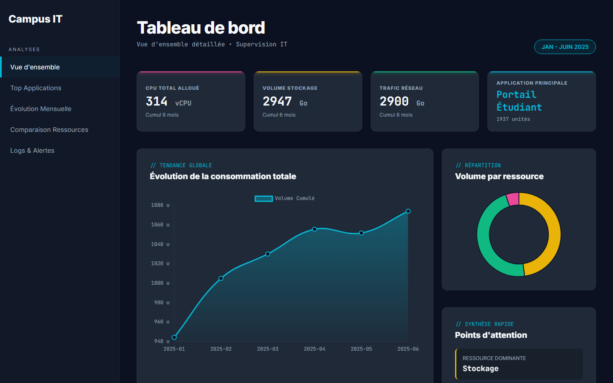
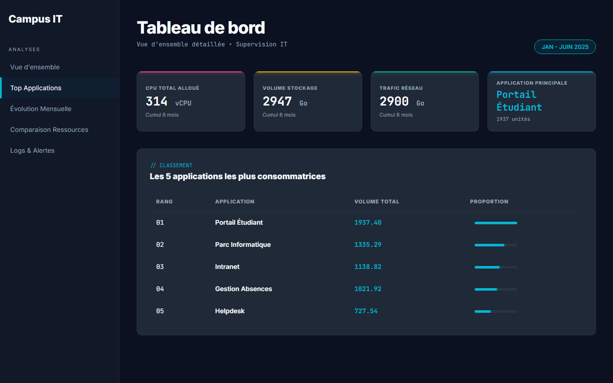
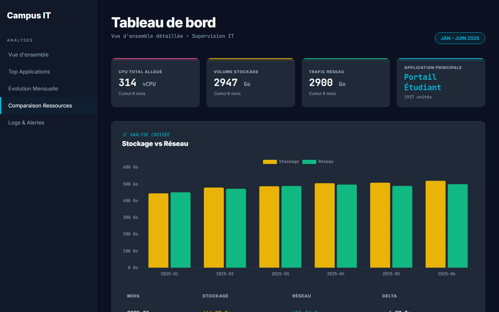

# Campus IT – Monitoring dashboard

[Version française](README.md)

Project built for the **DCSITGAMES** contest (BTS SIO, a French two-year IT degree): a
dashboard that tracks the IT resource usage (storage, CPU, network) of a campus's applications,
from January to June 2025.



## What the app does

| Tab                  | Content                                                     |
| -------------------- | ----------------------------------------------------------- |
| Overview             | CPU, storage and network totals, main application, trend    |
| Top Applications     | The 5 most resource-hungry applications                     |
| Monthly Trend        | Total usage month by month                                  |
| Resource Comparison  | Storage and network side by side, per month                 |
| Logs & Alerts        | The 5 biggest peaks in June (bonus task of the brief)       |

| Top Applications                                        | Comparison                                   |
| ------------------------------------------------------- | -------------------------------------------- |
|  |  |

The charts (Chart.js) read a small JSON API:

| Route                  | Response                                             |
| ---------------------- | ---------------------------------------------------- |
| `GET /api/top-apps`    | `[{ application, total }]`, 5 at most                |
| `GET /api/evolution`   | `[{ mois_fmt: "2025-01", total }]`                   |
| `GET /api/comparison`  | `[{ mois_fmt, stockage, reseau }]`                   |
| `GET /api/repartition` | `[{ ressource, total }]`                             |
| `GET /api/alertes`     | `[{ application, ressource, pic }]`, June, 5 at most |

## Tech stack

- PHP 8.2+, **Laravel 12** (query builder, migrations, seeders)
- **MariaDB 10.11** in production, SQLite for development and tests
- Chart.js for the charts
- PHPUnit, GitHub Actions

## Running the project

With SQLite, nothing but PHP and Composer is needed:

```bash
composer install
cp .env.example .env
php artisan key:generate
touch database/database.sqlite
php artisan migrate --seed   # tables + data from the brief (database/sql/data.sql)
php artisan serve            # http://127.0.0.1:8000
```

With MariaDB: uncomment the MariaDB block in `.env`, choose `DB_PASSWORD` and
`DB_ROOT_PASSWORD`, then run `docker compose up -d` before `php artisan migrate --seed`.

## Tests

```bash
php artisan test
```

The tests check every API route against a known dataset, as well as loading the data from the
brief. The queries avoid MySQL-specific functions (`SUBSTR` rather than `DATE_FORMAT`), so they
behave the same on SQLite and MariaDB.

## Structure

```
app/Http/Controllers/DashboardApiController.php   chart queries
database/migrations/                              application, ressource, consommation tables
database/sql/                                     schema and data provided by the brief
database/seeders/DonneesDemoSeeder.php            loads the data from the brief
resources/views/dashboard.blade.php               UI (5 tabs)
tests/Feature/DashboardApiTest.php                API tests
```

## Author

Alexis Renazé – [github.com/Optiware](https://github.com/Optiware)
