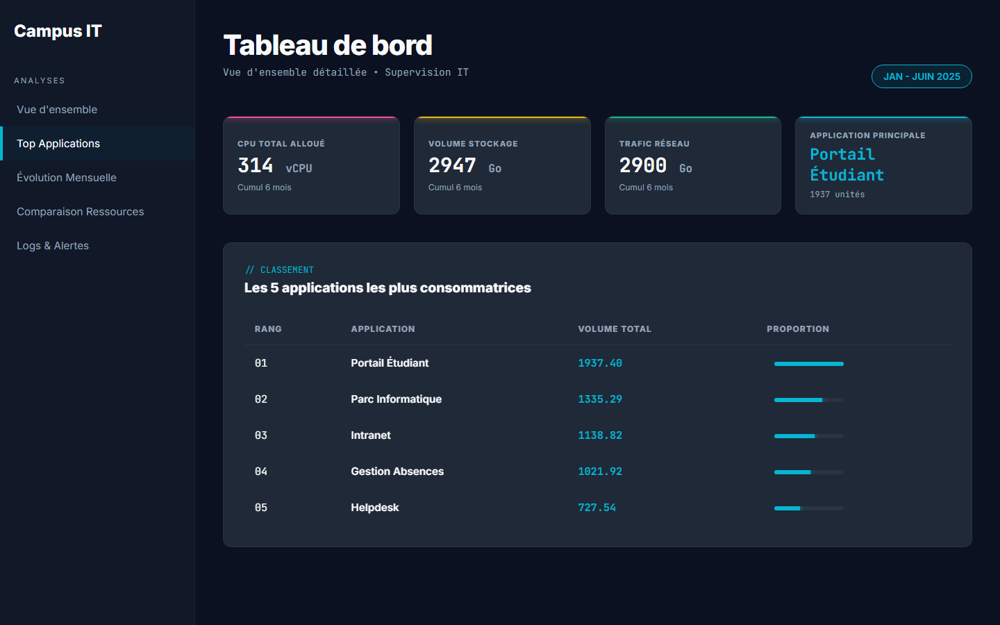
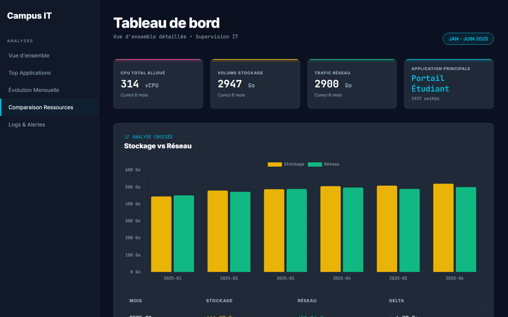

# Campus IT – Tableau de bord de supervision / Monitoring dashboard

Concours DCSITGAMES (BTS SIO) : consommation des ressources IT d'un campus.<br>
DCSITGAMES contest (BTS SIO): IT resource usage of a campus.


| Top Applications | Comparaison / Comparison |
| --- | --- |
|  |  |

<details>
<summary><b>🇫🇷 Français</b> (cliquer pour ouvrir)</summary>

<br>

Projet réalisé pour le concours **DCSITGAMES** (BTS SIO) : un tableau de bord qui suit la
consommation des ressources informatiques (stockage, CPU, réseau) des applications d'un campus,
de janvier à juin 2025.

### Ce que fait l'application

| Onglet                 | Contenu                                                              |
| ---------------------- | -------------------------------------------------------------------- |
| Vue d'ensemble         | Totaux CPU, stockage et réseau, application principale, évolution    |
| Top Applications       | Les 5 applications les plus consommatrices                           |
| Évolution Mensuelle    | Consommation totale mois par mois                                    |
| Comparaison Ressources | Stockage et réseau côte à côte, par mois                             |
| Logs & Alertes         | Les 5 plus gros pics de juin (bonus du sujet)                        |

Les graphiques (Chart.js) lisent une petite API JSON :

| Route                  | Réponse                                         |
| ---------------------- | ----------------------------------------------- |
| `GET /api/top-apps`    | `[{ application, total }]`, 5 au plus           |
| `GET /api/evolution`   | `[{ mois_fmt: "2025-01", total }]`              |
| `GET /api/comparison`  | `[{ mois_fmt, stockage, reseau }]`              |
| `GET /api/repartition` | `[{ ressource, total }]`                        |
| `GET /api/alertes`     | `[{ application, ressource, pic }]`, juin, 5 au plus |

### Technologies

- PHP 8.2+, **Laravel 12** (query builder, migrations, seeders)
- **MariaDB 10.11** en production, SQLite pour le développement et les tests
- Chart.js pour les graphiques
- PHPUnit, GitHub Actions

### Lancer le projet

Avec SQLite, rien d'autre que PHP et Composer :

```bash
composer install
cp .env.example .env
php artisan key:generate
touch database/database.sqlite
php artisan migrate --seed   # tables + données du sujet (database/sql/data.sql)
php artisan serve            # http://127.0.0.1:8000
```

Avec MariaDB : décommenter le bloc MariaDB du `.env`, choisir `DB_PASSWORD` et
`DB_ROOT_PASSWORD`, puis `docker compose up -d` avant `php artisan migrate --seed`.

### Tests

```bash
php artisan test
```

Les tests vérifient chaque route de l'API sur un jeu de données connu, ainsi que le chargement
des données du sujet. Les requêtes évitent les fonctions propres à MySQL (`SUBSTR` plutôt que
`DATE_FORMAT`) : elles passent à l'identique sur SQLite et sur MariaDB.

### Structure

```
app/Http/Controllers/DashboardApiController.php   requêtes des graphiques
database/migrations/                              tables application, ressource, consommation
database/sql/                                     schéma et données fournis par le sujet
database/seeders/DonneesDemoSeeder.php            chargement des données du sujet
resources/views/dashboard.blade.php               interface (5 onglets)
tests/Feature/DashboardApiTest.php                tests de l'API
```


</details>

<details>
<summary><b>🇬🇧 English</b> (click to open)</summary>

<br>

Project built for the **DCSITGAMES** contest (BTS SIO, a French two-year IT degree): a
dashboard that tracks the IT resource usage (storage, CPU, network) of a campus's applications,
from January to June 2025.

### What the app does

| Tab                  | Content                                                     |
| -------------------- | ----------------------------------------------------------- |
| Overview             | CPU, storage and network totals, main application, trend    |
| Top Applications     | The 5 most resource-hungry applications                     |
| Monthly Trend        | Total usage month by month                                  |
| Resource Comparison  | Storage and network side by side, per month                 |
| Logs & Alerts        | The 5 biggest peaks in June (bonus task of the brief)       |

The charts (Chart.js) read a small JSON API:

| Route                  | Response                                             |
| ---------------------- | ---------------------------------------------------- |
| `GET /api/top-apps`    | `[{ application, total }]`, 5 at most                |
| `GET /api/evolution`   | `[{ mois_fmt: "2025-01", total }]`                   |
| `GET /api/comparison`  | `[{ mois_fmt, stockage, reseau }]`                   |
| `GET /api/repartition` | `[{ ressource, total }]`                             |
| `GET /api/alertes`     | `[{ application, ressource, pic }]`, June, 5 at most |

### Tech stack

- PHP 8.2+, **Laravel 12** (query builder, migrations, seeders)
- **MariaDB 10.11** in production, SQLite for development and tests
- Chart.js for the charts
- PHPUnit, GitHub Actions

### Running the project

With SQLite, nothing but PHP and Composer is needed:

```bash
composer install
cp .env.example .env
php artisan key:generate
touch database/database.sqlite
php artisan migrate --seed   # tables + data from the brief (database/sql/data.sql)
php artisan serve            # http://127.0.0.1:8000
```

With MariaDB: uncomment the MariaDB block in `.env`, choose `DB_PASSWORD` and
`DB_ROOT_PASSWORD`, then run `docker compose up -d` before `php artisan migrate --seed`.

### Tests

```bash
php artisan test
```

The tests check every API route against a known dataset, as well as loading the data from the
brief. The queries avoid MySQL-specific functions (`SUBSTR` rather than `DATE_FORMAT`), so they
behave the same on SQLite and MariaDB.

### Structure

```
app/Http/Controllers/DashboardApiController.php   chart queries
database/migrations/                              application, ressource, consommation tables
database/sql/                                     schema and data provided by the brief
database/seeders/DonneesDemoSeeder.php            loads the data from the brief
resources/views/dashboard.blade.php               UI (5 tabs)
tests/Feature/DashboardApiTest.php                API tests
```


</details>

---

Alexis Renazé – [github.com/Optiware](https://github.com/Optiware)
