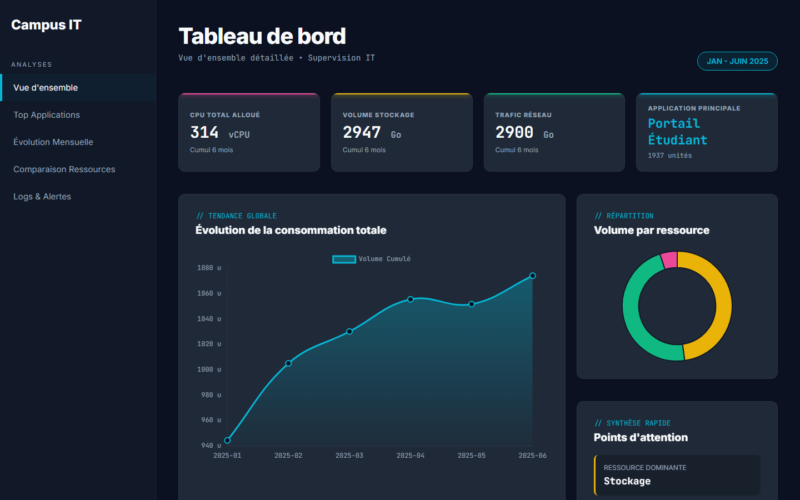

# Campus IT – Tableau de bord de supervision

Projet réalisé pour le concours **DCSITGAMES** (BTS SIO) : un tableau de bord qui suit la
consommation des ressources informatiques (stockage, CPU, réseau) des applications d'un campus,
de janvier à juin 2025.



## Ce que fait l'application

| Onglet                 | Contenu                                                              |
| ---------------------- | -------------------------------------------------------------------- |
| Vue d'ensemble         | Totaux CPU, stockage et réseau, application principale, évolution    |
| Top Applications       | Les 5 applications les plus consommatrices                           |
| Évolution Mensuelle    | Consommation totale mois par mois                                    |
| Comparaison Ressources | Stockage et réseau côte à côte, par mois                             |
| Logs & Alertes         | Les 5 plus gros pics de juin (bonus du sujet)                        |

| Top Applications                                    | Comparaison                                   |
| --------------------------------------------------- | --------------------------------------------- |
|  |  |

Les graphiques (Chart.js) lisent une petite API JSON :

| Route                  | Réponse                                         |
| ---------------------- | ----------------------------------------------- |
| `GET /api/top-apps`    | `[{ application, total }]`, 5 au plus           |
| `GET /api/evolution`   | `[{ mois_fmt: "2025-01", total }]`              |
| `GET /api/comparison`  | `[{ mois_fmt, stockage, reseau }]`              |
| `GET /api/repartition` | `[{ ressource, total }]`                        |
| `GET /api/alertes`     | `[{ application, ressource, pic }]`, juin, 5 au plus |

## Technologies

- PHP 8.2+, **Laravel 12** (query builder, migrations, seeders)
- **MariaDB 10.11** en production, SQLite pour le développement et les tests
- Chart.js pour les graphiques
- PHPUnit, GitHub Actions

## Lancer le projet

Avec SQLite, rien d'autre que PHP et Composer :

```bash
composer install
cp .env.example .env
php artisan key:generate
touch database/database.sqlite
php artisan migrate --seed   # tables + données du sujet (database/sql/data.sql)
php artisan serve            # http://127.0.0.1:8000
```

Avec MariaDB : décommenter le bloc MariaDB du `.env`, choisir `DB_PASSWORD` et
`DB_ROOT_PASSWORD`, puis `docker compose up -d` avant `php artisan migrate --seed`.

## Tests

```bash
php artisan test
```

Les tests vérifient chaque route de l'API sur un jeu de données connu, ainsi que le chargement
des données du sujet. Les requêtes évitent les fonctions propres à MySQL (`SUBSTR` plutôt que
`DATE_FORMAT`) : elles passent à l'identique sur SQLite et sur MariaDB.

## Structure

```
app/Http/Controllers/DashboardApiController.php   requêtes des graphiques
database/migrations/                              tables application, ressource, consommation
database/sql/                                     schéma et données fournis par le sujet
database/seeders/DonneesDemoSeeder.php            chargement des données du sujet
resources/views/dashboard.blade.php               interface (5 onglets)
tests/Feature/DashboardApiTest.php                tests de l'API
```

## Auteur

Alexis Renazé – [github.com/Optiware](https://github.com/Optiware)
